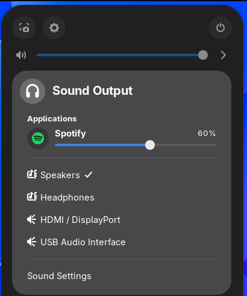

# App Volume Mixer

Per-app volume control for GNOME. Open Quick Settings, click the **›** next to the volume slider, and every app that's playing audio gets its own slider and mute button.



- **Per-app slider**: turn one app down without touching the others.
- **One-click mute**: click an app's icon to mute it. Click again to unmute.
- **Grouped streams**: apps with several streams (browser tabs, games) get one row.
- **Stays in sync**: changes made in the app itself, pavucontrol or GNOME Settings show up right away.
- **Native look**: it lives in GNOME's own sound menu, next to your output devices, and respects the "Over-Amplification" setting.

Works with PipeWire and PulseAudio on **GNOME 46 to 51**.

## Install

You need the GNOME desktop. Copy and paste the command for your system into a terminal, then **log out and back in**.

### Arch, Manjaro, EndeavourOS, CachyOS

```bash
curl -fsSL https://raw.githubusercontent.com/Jire/app-volume-mixer/main/install.sh | bash
```

### Ubuntu 24.04+ and Ubuntu-based GNOME distros

```bash
wget -qO- https://raw.githubusercontent.com/Jire/app-volume-mixer/main/install.sh | bash
```

(Ubuntu doesn't always ship `curl`, but it always ships `wget`.)

### Fedora Workstation 40+

```bash
curl -fsSL https://raw.githubusercontent.com/Jire/app-volume-mixer/main/install.sh | bash
```

The script installs the latest release into your home folder (no `sudo`) and enables it. GNOME only loads newly installed extensions when you log in, so log out and back in once. Running the same command again updates the extension.

<details>
<summary>Other ways to install</summary>

**From a release zip:** download `app-volume-mixer@jire.github.io.shell-extension.zip` from [Releases](https://github.com/Jire/app-volume-mixer/releases/latest), then:

```bash
gnome-extensions install --force app-volume-mixer@jire.github.io.shell-extension.zip
gnome-extensions enable app-volume-mixer@jire.github.io
```

**From source:**

```bash
git clone https://github.com/Jire/app-volume-mixer.git
cd app-volume-mixer
./install.sh
```

</details>

## Uninstall

```bash
curl -fsSL https://raw.githubusercontent.com/Jire/app-volume-mixer/main/install.sh | bash -s -- --uninstall
```

(Use `wget -qO-` instead of `curl -fsSL` on Ubuntu.) Or remove it in the **Extensions** app.

## Troubleshooting

- **The › arrow doesn't show:** it appears when at least one app is playing audio, or when you have more than one output device. Start something playing and reopen Quick Settings.
- **Nothing changed after installing:** log out and back in. Check that it's on in the **Extensions** app, and that the **Use Extensions** switch at the top is on.
- **"not in this extension's supported versions":** your GNOME is older than 46 or newer than this release. Please [open an issue](https://github.com/Jire/app-volume-mixer/issues) with the output of `gnome-shell --version`.
- **Errors:** run `journalctl --user -b -g app-volume-mixer` and include the output in an issue.

## Development

The extension is three files in [`src/`](src): `extension.js`, `metadata.json` and `stylesheet.css`. Run `./install.sh` from a clone to install your working copy.

To try changes without logging out, use [`tools/hot-load.js`](tools/hot-load.js): run `./install.sh`, open Looking Glass (<kbd>Alt</kbd>+<kbd>F2</kbd>, `lg`) and paste the `eval(...)` line from the top of that file. On GNOME 49+ you can also test in a nested shell window:

```bash
dbus-run-session gnome-shell --devkit
```

Releases are built by [GitHub Actions](.github/workflows/release.yml): push a tag such as `v2` and the workflow attaches the installable zip to a new release.

## License

[GPL-2.0-or-later](LICENSE), the same license as GNOME Shell.
